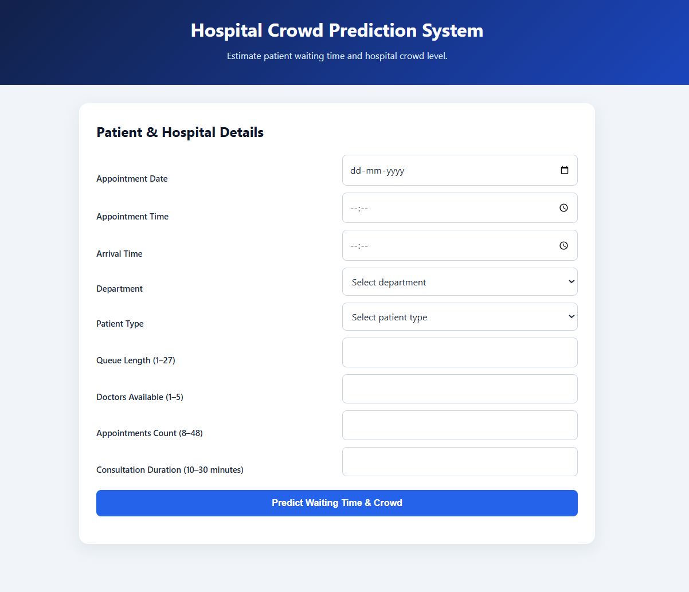
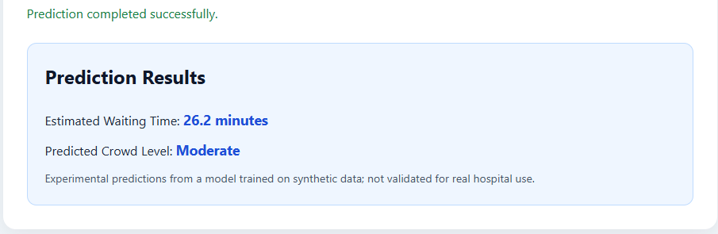

# Hospital Crowd & Waiting Time Prediction System

An end-to-end machine learning project that estimates hospital patient waiting time and classifies crowd levels using appointment, queue, staffing, and consultation information.

> **Important:** This is an educational prototype trained on synthetic data. Its predictions have not been validated for real hospital operations and should not be used for clinical or operational decisions.

## Project Overview

Long patient queues and unpredictable waiting times can make hospital visits difficult to plan. This project explores how data analysis and machine learning can be used to estimate waiting time and identify crowd levels from structured hospital-visit information.

The project includes data generation, exploratory data analysis, feature engineering, SQL analysis, machine learning model training, and a Flask web application.

## Features

- Generate and analyze a synthetic hospital dataset.
- Explore patient visits, departments, queues, and waiting times.
- Engineer date, time, weekend, peak-hour, and categorical features.
- Store and query data using SQLite.
- Compare regression models for waiting-time estimation.
- Train a classifier for crowd-level prediction.
- Serve predictions through a Flask REST API.
- Use a browser-based form to submit inputs and view prediction results.
- Validate input fields and return understandable API errors.

## Technology Stack

- **Language:** Python
- **Data analysis:** Pandas, NumPy
- **Machine learning:** scikit-learn
- **Model persistence:** Joblib
- **Database:** SQLite
- **API and backend:** Flask
- **Frontend:** HTML, CSS, JavaScript
- **Visualization and analysis:** Matplotlib, Seaborn, Jupyter Notebook
- **Version control:** Git and GitHub

## Project Structure

```text
Hospital-Crowd-Prediction/
├── app/
│   ├── app.py
│   ├── templates/
│   │   └── index.html
│   └── static/
│       ├── style.css
│       └── script.js
├── data/
│   ├── hospital_data.csv
│   ├── processed_hospital_data.csv
│   └── hospital.db
├── models/
│   ├── crowd_model.pkl
│   ├── waiting_model.pkl
│   └── waiting_time_model.pkl
├── notebooks/
│   ├── 02_eda.ipynb
│   ├── 03_feature_engineering.ipynb
│   └── 04_model_training.ipynb
├── src/
│   ├── database.py
│   ├── generate_data.py
│   ├── prediction.py
│   ├── preprocessing.py
│   └── test_setup.py
├── .gitignore
├── requirements.txt
└── README.md
```

## Dataset

The project uses a synthetically generated dataset containing 12,000 records and 12 original columns, including:

- Patient ID
- Appointment date and time
- Arrival time
- Department and doctor ID
- Patient type
- Queue length
- Doctors available
- Appointment count
- Consultation duration
- Waiting time in minutes

The processed dataset contains engineered features and encoded categorical variables.

No claim is made that these records represent actual hospital patients.

## Machine Learning

### Waiting-time regression

Several regression algorithms were compared during model development:

| Model | MAE | RMSE | R² |
|---|---:|---:|---:|
| Linear Regression | 3.89 | 4.84 | 0.78 |
| Decision Tree Regressor | 3.94 | 5.06 | 0.76 |
| Random Forest Regressor | 3.76 | 4.77 | 0.79 |
| Gradient Boosting Regressor | 3.69 | 4.70 | 0.79 |

These results are from the project's synthetic dataset and its particular train/test split. They do not establish performance on real hospital data.

### Crowd-level classification

The crowd labels are generated from queue length:

- **Low:** queue length of 8 or fewer
- **Moderate:** queue length from 9 to 15
- **High:** queue length greater than 15

Because queue length is directly used to define the target, perfect classification scores are expected when the same rule is available to the model. These scores are not evidence of real-world predictive ability.

## Run Locally

### 1. Clone the repository

```bash
git clone https://github.com/Vinaysoni0081/Hospital-Crowd-Prediction.git<YOUR_GITHUB_REPOSITORY_URL>
cd Hospital-Crowd-Prediction
```


### 2. Create and activate a virtual environment

Windows PowerShell:

```powershell
python -m venv .venv
.\.venv\Scripts\Activate.ps1
```

### 3. Install dependencies

```powershell
python -m pip install -r requirements.txt
```

### 4. Start the web application

From the project root:

```powershell
python app/app.py
```

Open this address in your browser:

```text
http://127.0.0.1:5000/
```

The health endpoint can be checked at:

```text
http://127.0.0.1:5000/health
```

The prediction endpoint accepts JSON requests at `POST /predict`.

**Note:** The repository must include the required model files and processed data artifacts, or provide documented steps to regenerate them, before the application can run successfully.


## Screenshots

### Application Homepage



### Prediction Results




## Future Improvements

- Evaluate models on real, appropriately anonymized hospital data with permission.
- Use time-based or hospital-wise validation to test generalization.
- Improve feature engineering and model monitoring.
- Add a Power BI dashboard for operational analytics.
- Add automated tests and API documentation.
- Improve deployment, logging, and application security.

Disclaimer

This project is intended for learning, demonstration, and portfolio purposes only. It is not a validated hospital decision-support system.

Author

Vinay Soni

GitHub: Vinaysoni0081

LinkedIn: https://www.linkedin.com/in/vinay-soni-3769b8303/